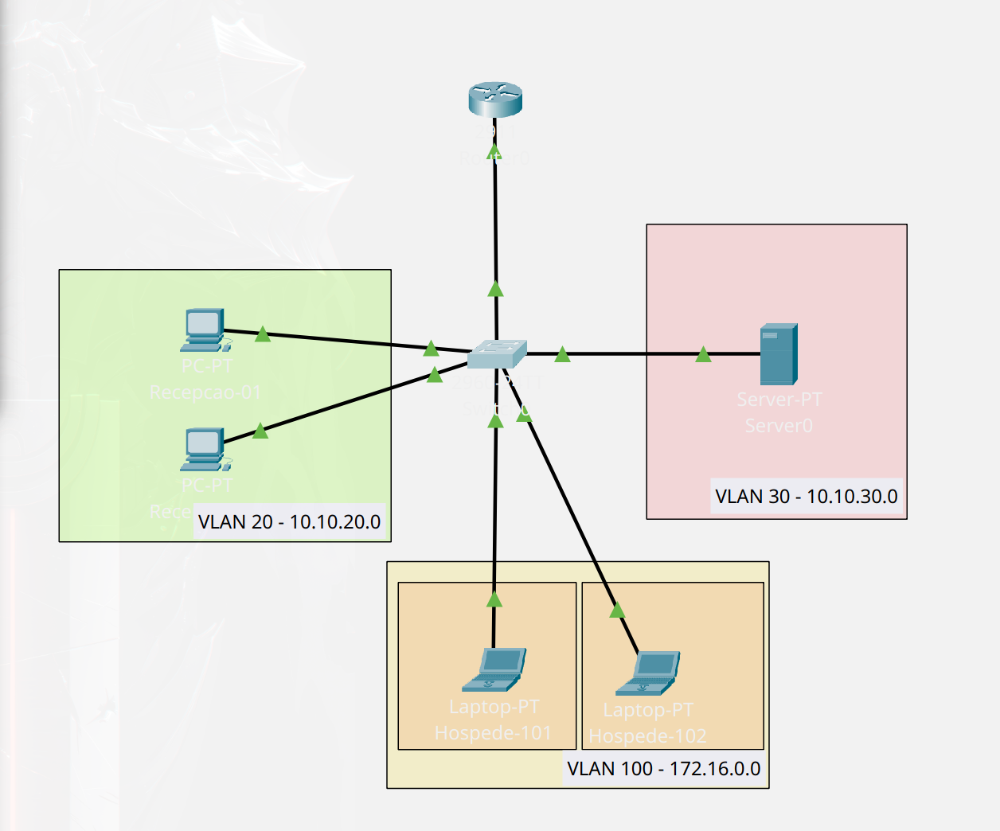

# 🏨 Arquitetura de Rede Hoteleira: Segmentação L2/L3 e Isolamento de Clientes


## 📌 Visão Geral e Caso de Uso

Redes de hospitalidade (hotéis, pousadas e centros de convenções) enfrentam um desafio crítico de segurança: compartilhar a mesma infraestrutura física de switches e roteadores entre sistemas internos sensíveis (Recepção/PMS, servidores administrativos e câmeras de segurança CFTV) e centenas de dispositivos não confiáveis de hóspedes.

Este projeto implementa uma topologia de rede corporativa no **Cisco Packet Tracer** focada em **mitigar varreduras de rede (Nmap/ARP scanning), interceptação de tráfego e movimentação lateral**, garantindo que:
1. Hóspedes tenham acesso à Internet/Gateway, mas sejam **totalmente invisíveis uns aos outros** na Camada 2 (mesmo estando na mesma VLAN e sub-rede).
2. O tráfego de hóspedes seja **bloqueado na Camada 3** contra qualquer tentativa de conexão às sub-redes de CFTV (câmeras IP) e Recepção.
3. O setor de Recepção mantenha acesso administrativo ao monitoramento de câmeras (CFTV) via roteamento Inter-VLAN controlado.

---

## 🏗️ Topologia da Rede

>

### Tecnologias e Protocolos Implementados
* **Segmentação L2 (VLANs & IEEE 802.1Q Trunking):** Separação de domínios de broadcast por departamento e encapsulamento `.1Q` no uplink entre Switch e Roteador.
* **Isolamento de Clientes L2 (`switchport protected` / Port Isolation):** Prevenção de comunicação direta (Unicast, Multicast e Broadcast/ARP) entre quartos de hóspedes na mesma VLAN.
* **Roteamento Inter-VLAN (*Router-on-a-Stick*):** Sub-interfaces virtuais configuradas no roteador central atuando como gateways padrão para cada segmento.
* **Filtragem de Pacotes L3 (Extended ACLs):** Listas de controle de acesso aplicadas na entrada (`inbound`) da sub-interface de hóspedes para bloquear tráfego destinado às redes privadas internas (RFC 1918).
* **Provisionamento Dinâmico (DHCP Server):** Escopos independentes por VLAN com reserva de endereços de gerência (`excluded-address`) e convergência imediata de portas de acesso via **Spanning Tree PortFast**.

---

## 🗺️ Plano de Endereçamento IP e VLANs

| VLAN ID | Nome / Setor | Sub-rede (CIDR) | Gateway Padrão | Interfaces (Switch 2960) | Política de Isolamento / Segurança |
| :---: | :--- | :--- | :--- | :--- | :--- |
| **20** | `RECEPCAO` | `10.10.20.0/24` | `10.10.20.1` | `Fa0/1 - Fa0/2` | Comunicação interna liberada + Acesso à VLAN 30 |
| **30** | `CFTV_CAMERAS` | `10.10.30.0/24` | `10.10.30.1` | `Fa0/3` | Rede restrita de monitoramento e gravadores NVR |
| **100** | `HOSPEDES` | `172.16.0.0/24` | `172.16.0.1` | `Fa0/10 - Fa0/11` | **L2 Port Isolation** ativo + **L3 Extended ACL** |
| **Trunk** | `UPLINK_ROUTER` | *N/A (802.1Q)* | *N/A* | `Gig0/1` $\leftrightarrow$ `Gig0/0` | Transporte marcado das VLANs `20, 30, 100` |

### Inventário de Dispositivos Simulados

| Host | Setor / Local | Endereço IP | Máscara | Porta no Switch |
| :--- | :--- | :--- | :--- | :--- |
| **PC0** | Recepção Terminal 01 | `10.10.20.10` (ou DHCP) | `255.255.255.0` | `FastEthernet 0/1` |
| **PC1** | Recepção Terminal 02 | `10.10.20.11` (ou DHCP) | `255.255.255.0` | `FastEthernet 0/2` |
| **Server0** | Câmera IP / NVR CFTV | `10.10.30.50` (Estático) | `255.255.255.0` | `FastEthernet 0/3` |
| **Laptop0** | Hóspede - Quarto 101 | `172.16.0.10` (DHCP) | `255.255.255.0` | `FastEthernet 0/10` *(Protected)* |
| **Laptop1** | Hóspede - Quarto 102 | `172.16.0.11` (DHCP) | `255.255.255.0` | `FastEthernet 0/11` *(Protected)* |

---

## 🧪 Validação e Testes de Segurança

Para comprovar a eficácia das políticas de isolamento, foram executados quatro cenários de teste de conectividade e inspeção de pacotes (ICMP/ARP):

| # | Origem | Destino | Resultado Esperado | Camada de Atuação / Mecanismo |
| :-: | :--- | :--- | :---: | :--- |
| **1** | **Quarto 101** (`172.16.0.10`) | **Quarto 102** (`172.16.0.11`) | ❌ **Bloqueado** (*Request Timed Out*) | **Camada 2 (Switch):** Quadro ARP descartado entre portas com `switchport protected`. |
| **2** | **Quarto 101** (`172.16.0.10`) | **Câmera CFTV** (`10.10.30.50`) | ❌ **Bloqueado** (*Destination Host Unreachable*) | **Camada 3 (Router):** Pacote descartado pela ACL `BLOQUEIA_HOSPEDES` na sub-interface `.100`. |
| **3** | **Quarto 101** (`172.16.0.10`) | **Gateway Hóspedes** (`172.16.0.1`) | ✅ **Permitido** (*Reply from 172.16.0.1*) | Porta protegida possui permissão de comunicação com a porta de Uplink/Promíscua. |
| **4** | **Recepção PC0** (`10.10.20.10`) | **Câmera CFTV** (`10.10.30.50`) | ✅ **Permitido** (*Reply from 10.10.30.50*) | Roteamento Inter-VLAN normal entre `Gi0/0.20` e `Gi0/0.30`. |

---

## ⚙️ Principais Trechos de Configuração (Cisco IOS)

Os arquivos completos de configuração estão disponíveis no diretório [`/configs`](./configs). Abaixo estão os blocos essenciais da implementação:

### 1. Switch L2 (Cisco 2960) — VLANs, Port Isolation e Trunk
```ios
! Criação das VLANs
vlan 20
 name RECEPCAO
vlan 30
 name CFTV_CAMERAS
vlan 100
 name HOSPEDES

! Isolamento de Camada 2 entre quartos de hóspedes (PVLAN Edge / Protected Port)
interface range FastEthernet 0/10 - 11
 switchport mode access
 switchport access vlan 100
 switchport protected
 spanning-tree portfast

! Uplink Trunk IEEE 802.1Q para o Roteador
interface GigabitEthernet 0/1
 switchport mode trunk
 switchport trunk allowed vlan 20,30,100
